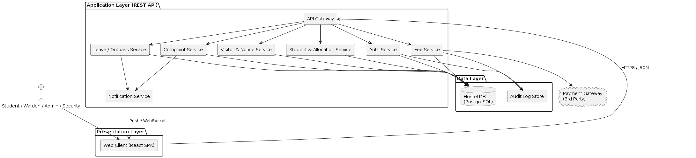
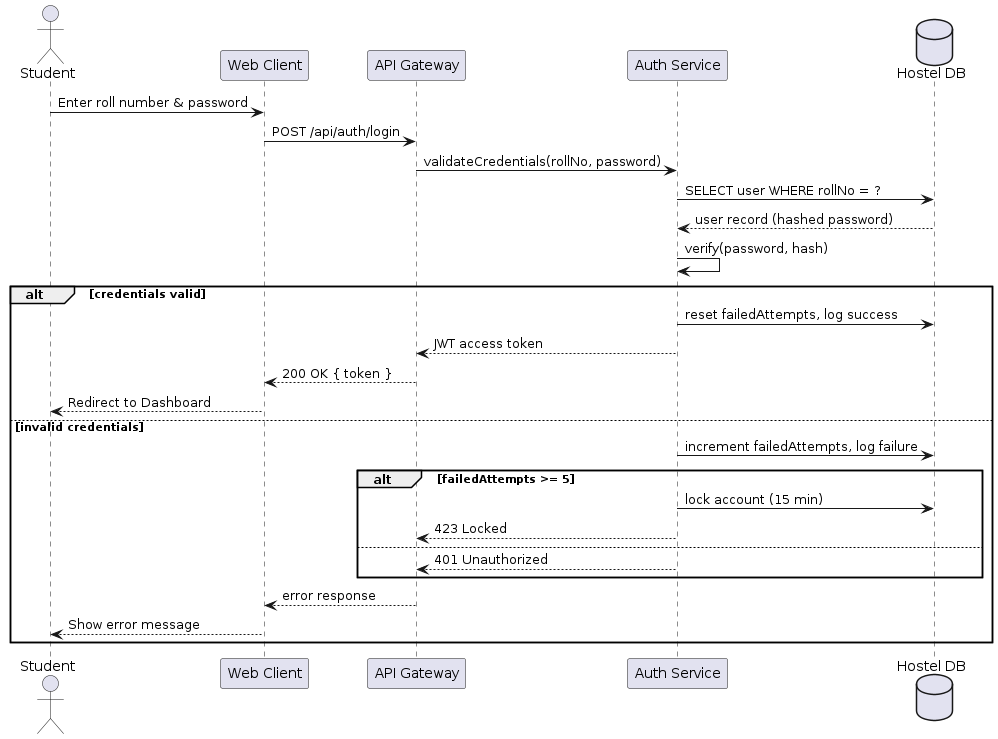
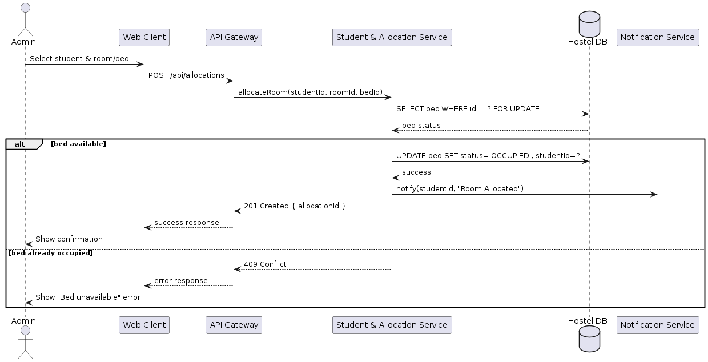
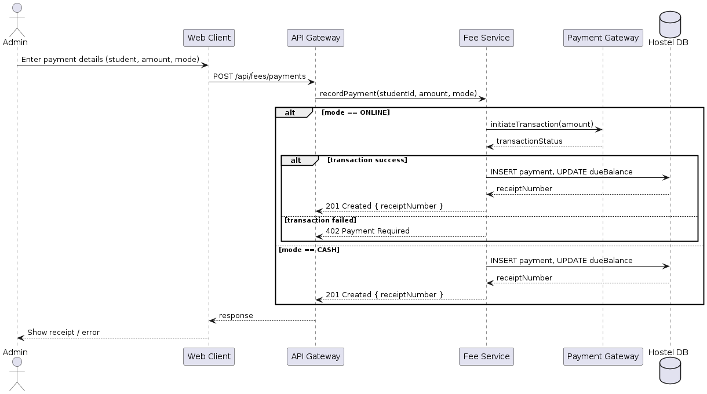

# Software Architecture & Design Specification

---

## 1. Introduction

### 1.1 Purpose

This document describes the software architecture and detailed design of the Hostel Management System (HMS), translating the requirements in the [Software Requirements Specification](SRS.md) into a concrete component structure, technology choices, and interaction designs.

### 1.2 Scope

Covers the system's architectural style, component decomposition, security architecture, API design, sequence-level behavior for key use cases, and error-handling strategy. It does not cover low-level class implementation, which is left to the implementation phase.

### 1.3 References

- [SRS.md](SRS.md) — Software Requirements Specification, v1.0.
- [Test_Plan.md](Test_Plan.md) — Test Plan, v1.0.
- IEEE Std 1016-2009.

### 1.4 Overview

Section 2 gives a system overview. Section 3 presents the architecture (pattern, component diagram, security architecture, traceability). Section 4 presents the detailed design (sequence diagrams, API design, data design, error handling).

---

## 2. System Overview

HMS is a three-tier web application: a browser-based **Web Client**, a set of **REST API services** implementing business logic, and a **relational database** for persistence, with a single external integration to a third-party **Payment Gateway** for online fee payments.

---

## 3. Architectural Design

### 3.1 Architecture Pattern

HMS follows a **layered (n-tier) client–server architecture** combined with a **service-oriented decomposition** within the application layer:

1. **Presentation Layer** — Web Client (single-page application).
2. **Application Layer** — an API Gateway fronting independently-deployable domain services (Auth, Student & Allocation, Fee, Complaint, Leave/Outpass, Visitor & Notice, Notification).
3. **Data Layer** — a relational database plus an append-only audit log store.

This pattern was chosen over a monolithic MVC design because it (a) cleanly maps each service to a bounded set of FRs from the SRS, simplifying traceability and independent testing, and (b) isolates the security-sensitive Auth and Fee services so that access-control and audit-logging concerns (SEC-REQ-1 through SEC-REQ-5) are centralized rather than duplicated.

### 3.2 Component Diagram

*Source: `diagrams/src/component-diagram.puml`*

### 3.3 Component Descriptions

| Component | Responsibility |
|---|---|
| Web Client | Renders role-specific UI (Student/Warden/Admin/Security); performs client-side validation; calls the API Gateway over HTTPS. |
| API Gateway | Single entry point; terminates TLS, routes requests to domain services, enforces coarse-grained rate limiting. |
| Auth Service | Registration, login, password hashing/verification, account lockout, JWT issuance, RBAC role assignment. |
| Student & Allocation Service | Student profile management, room/bed allocation and lookup. |
| Fee Service | Fee-due tracking, payment recording (cash/online), receipt generation, Payment Gateway integration. |
| Complaint Service | Complaint submission, status transitions, warden remarks. |
| Leave/Outpass Service | Leave/outpass request submission and warden approval/rejection workflow. |
| Visitor & Notice Service | Visitor entry/exit logging; notice/announcement posting and retrieval. |
| Notification Service | Delivers in-app notifications (e.g., leave decisions) to the Web Client. |
| Hostel DB | Authoritative relational store for all domain entities. |
| Audit Log Store | Append-only store for authentication events and administrative actions (SEC-REQ-5). |

### 3.4 Traceability to Requirements

| Component | Traces to Requirement(s) |
|---|---|
| Auth Service | FR-1, FR-2, SEC-REQ-1, SEC-REQ-2, SEC-REQ-5 |
| Student & Allocation Service | FR-3, FR-4, NFR-4 |
| Fee Service | FR-4, FR-10, SEC-REQ-5 |
| Complaint Service | FR-5, FR-6 |
| Leave/Outpass Service | FR-7, FR-8, NFR-7 |
| Visitor & Notice Service | FR-9, FR-11, FR-12 |
| Notification Service | FR-8 |
| API Gateway | SEC-REQ-3, SEC-REQ-4, NFR-8 |
| Hostel DB / Audit Log Store | NFR-7, SEC-REQ-5 |

### 3.5 Security Architecture

- **Perimeter:** all external traffic terminates TLS at the API Gateway (SEC-REQ-3); plaintext HTTP is rejected.
- **Authentication:** the Auth Service issues short-lived JWT access tokens after verifying bcrypt-hashed credentials (SEC-REQ-1); 5 consecutive failed attempts trigger a 15-minute account lockout (FR-2).
- **Authorization:** every downstream service enforces RBAC by validating the caller's role claim from the JWT before executing a request (SEC-REQ-2) — e.g., the Fee Service rejects a Student request for another student's ledger.
- **Input validation:** the API Gateway and each domain service validate and sanitize all inbound payloads against a schema to mitigate SQL Injection and XSS (SEC-REQ-4).
- **Auditing:** the Auth Service and Fee Service emit events to the append-only Audit Log Store for every authentication attempt and administrative fee/allocation change (SEC-REQ-5).
- **Defense in depth:** the database layer uses parameterized queries exclusively (no dynamic SQL string concatenation), and the API Gateway applies per-IP rate limiting on `/api/auth/login` to blunt brute-force attempts (supports SEC-OBJ-3).

### 3.6 Deployment View / Technology Stack

| Layer | Technology |
|---|---|
| Web Client | React SPA (responsive, targets latest two versions of Chrome/Firefox/Edge — NFR-6) |
| API Services | Node.js (Express) REST services, containerized, behind the API Gateway |
| Database | PostgreSQL |
| Transport | HTTPS/TLS 1.2+ |
| Payment Integration | Third-party Payment Gateway REST API (sandbox for testing) |

---

## 4. Detailed Design

### 4.1 Sequence Diagrams

#### 4.1.1 Login / Authentication (traces FR-2, SEC-REQ-1, SEC-REQ-5)

*Source: `diagrams/src/sequence-login.puml`*

#### 4.1.2 Room Allocation (traces FR-3)

*Source: `diagrams/src/sequence-room-allocation.puml`*

#### 4.1.3 Fee Payment (traces FR-10)

*Source: `diagrams/src/sequence-fee-payment.puml`*

### 4.2 API Design

All endpoints are served under `/api`, accept and return JSON, and require a valid `Authorization: Bearer <JWT>` header unless noted.

| Method | Endpoint | Description | Auth | Traces To |
|---|---|---|---|---|
| POST | `/api/auth/register` | Register a new student account | Public | FR-1 |
| POST | `/api/auth/login` | Authenticate and obtain a JWT | Public | FR-2 |
| GET | `/api/students/{id}/allocation` | View a student's room/bed allocation and dues | Student (self), Admin | FR-4 |
| POST | `/api/allocations` | Allocate a room/bed to a student | Admin | FR-3 |
| POST | `/api/complaints` | Submit a maintenance complaint | Student | FR-5 |
| PATCH | `/api/complaints/{id}` | Update complaint status/remark | Warden | FR-6 |
| POST | `/api/leaves` | Submit a leave/outpass request | Student | FR-7 |
| PATCH | `/api/leaves/{id}` | Approve/reject a leave request | Warden | FR-8 |
| POST | `/api/visitors` | Log visitor entry | Security | FR-9 |
| PATCH | `/api/visitors/{id}/exit` | Log visitor exit | Security | FR-9 |
| POST | `/api/fees/payments` | Record a fee payment | Admin | FR-10 |
| POST | `/api/notices` | Post a notice/announcement | Admin | FR-11 |
| GET | `/api/reports/occupancy` | Generate occupancy report (PDF) | Admin | FR-12 |

Each endpoint returns standard HTTP status codes: `200`/`201` on success, `400` on validation failure, `401` on missing/invalid auth, `403` on RBAC denial, `404` on missing resource, `409` on state conflict (e.g., bed already occupied), `423` on account lockout, `429` on rate-limit rejection, `500` on unexpected server error.

### 4.3 Data Design (Overview)

Core entities: `User` (Student/Warden/Admin/Security, with hashed credentials and role), `HostelBlock`, `Room`, `Bed` (status: VACANT/OCCUPIED), `Allocation`, `FeeLedger`, `Payment`, `Complaint`, `LeaveRequest`, `VisitorLog`, `Notice`, `AuditLogEntry`. Foreign keys enforce that a `Bed` can have at most one active `Allocation`, and a `FeeLedger` belongs to exactly one `User`.

### 4.4 Error Handling

- **Validation errors** (malformed/missing fields) are caught at the API Gateway and domain-service boundary and returned as `400` with a machine-readable error code and human-readable message; no partial writes occur.
- **Concurrency conflicts** (e.g., two admins allocating the same bed) are handled with a row-level lock (`SELECT ... FOR UPDATE`) in the Student & Allocation Service; the loser of the race receives `409 Conflict` rather than silently overwriting state (see Section 4.1.2).
- **External-dependency failures** (Payment Gateway timeout/decline) are caught in the Fee Service, mapped to `402 Payment Required`, and never leave the fee ledger in a partially-updated state — the database write only occurs after a confirmed successful transaction (see Section 4.1.3).
- **Authentication/authorization errors** return `401`/`403` without leaking whether a given username exists (to avoid user enumeration).
- **Unhandled exceptions** are caught by a global error-handling middleware in each service, logged with a correlation ID, and returned to the client as a generic `500` response that does not expose stack traces or internal implementation details.
- **Persistence-before-acknowledgment**: to satisfy NFR-7, each service commits a submission to the database (and receives a durable write confirmation) before returning a success response to the client.

### 4.5 Design Constraints

- All inter-service and client-service calls occur over HTTPS; no service accepts plaintext HTTP (SEC-REQ-3).
- No domain service accesses another service's database tables directly — all cross-service data access goes through the owning service's API, preserving the traceability and RBAC boundaries defined in Section 3.4 and 3.5.

---

## 5. Appendices

### Appendix A — Diagram Source Files

All PlantUML source files used to generate the diagrams in this document are located under `docs/diagrams/src/`. Rendered PNGs are under `docs/diagrams/`.
