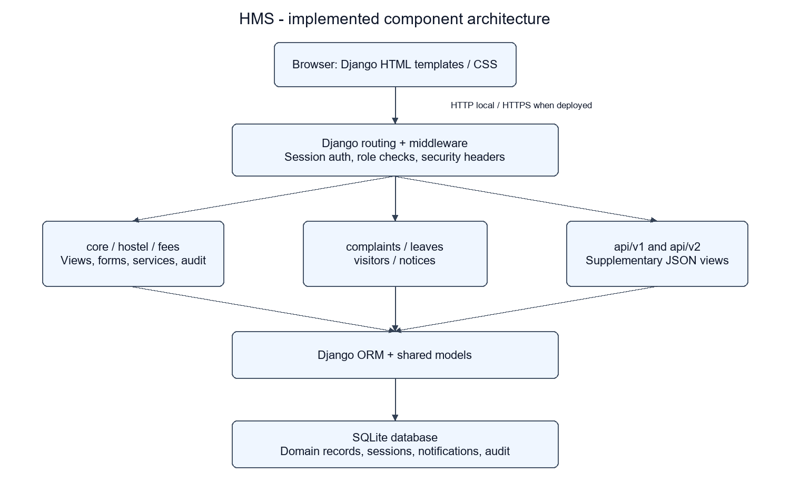
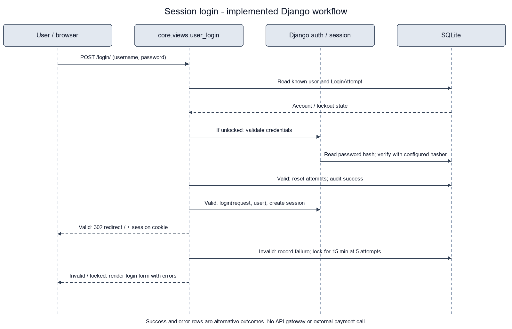
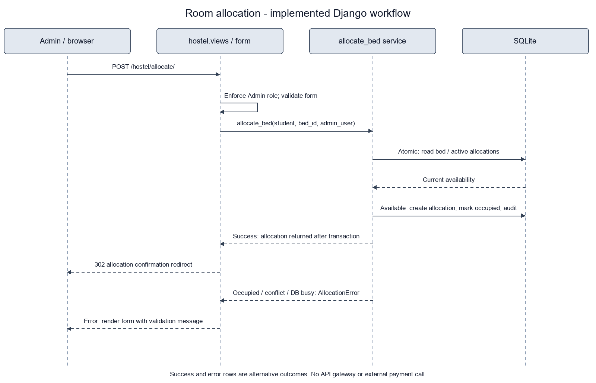
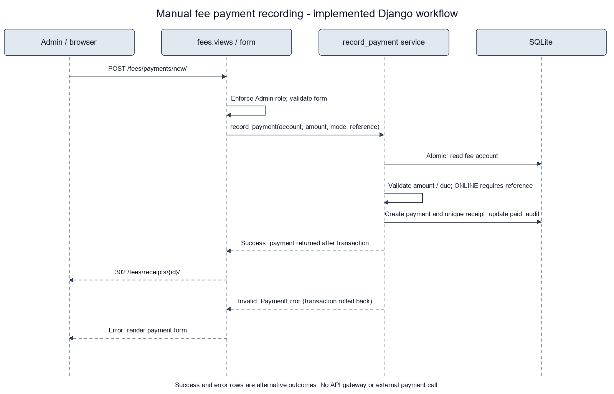

# Software Architecture & Design Specification

Version: 2.0 | As implemented: 19 November 2026

## 1. Introduction

### 1.1 Purpose
This IEEE 1016-oriented description records the implemented Hostel Management System (HMS). It replaces the original React/Express service design with the actual Django architecture. Requirements identifiers retain their meaning from [SRS](SRS.md); a mapping is not a claim that every acceptance criterion has passed.

### 1.2 Scope
Covers components, interactions, persistence, security, interfaces, error handling, deployment and requirement traceability. [Design Deviations](Design_Deviations.md) records differences from the submitted baseline, their consequences and unresolved acceptance gaps. No application behaviour is changed by this documentation revision.

### 1.3 References
- IEEE Std 1016-2009, Software Design Descriptions.
- [Original SRS](SRS.md), [Test Plan](Test_Plan.md), [REST API catalogue](REST_API.md).
- Implementation: `config/`, `core/`, `hostel/`, `fees/`, `complaints/`, `leaves/`, `visitors/`, `notices/`, `api/`.

## 2. System Overview
HMS is one Django application with server-rendered HTML and supplementary versioned JSON endpoints. Four roles (Student, Warden, Admin and Security Guard) share Django authentication; `core.UserProfile` stores role and block. Browser forms call Django views directly. JSON endpoints run in the same process and share the same ORM/database. There is no React SPA, independently deployed domain service, API gateway, JWT issuer, WebSocket server or external payment processor.

## 3. Architectural Design

### 3.1 Pattern and Rationale
A modular monolith follows Django's model-template-view pattern. Templates and CSS form the presentation layer; URL routing, middleware, forms, views and selected service functions implement application behaviour; the ORM persists models to SQLite. Domain apps separate responsibilities without network or database ownership boundaries. This reduces setup and deployment complexity for a local academic demonstration, but does not demonstrate independent service scaling or production readiness.

### 3.2 Component Diagram

Editable UML: [component-diagram.puml](diagrams/src/component-diagram.puml).

### 3.3 Components and Requirement Traceability
| Component | Implemented responsibility | Requirements supported |
|---|---|---|
| Templates / static CSS | Server-rendered forms, navigation, dashboards, receipts | FR-1..12, NFR-3, NFR-6 |
| core | Registration, login/lockout, sessions, role/block profiles, notifications, audit events and health check | FR-1, FR-2, FR-8; SEC-REQ-1,2,5 |
| hostel | Room/bed inventory, transactional allocation, student dashboard and occupancy PDF | FR-3, FR-4, FR-12; NFR-1,4 |
| fees | Fee accounts, manual cash/online-reference recording, receipts | FR-4, FR-10; SEC-REQ-5 |
| complaints | Complaint forms, student submission, warden management | FR-5, FR-6; NFR-3,7 |
| leaves | Submission, block routing, warden decisions, persisted notifications | FR-7, FR-8; NFR-7 |
| visitors | Security-guard entry/exit recording | FR-9 |
| notices | General/block notices and notifications | FR-11 |
| api/v1 and api/v2 | Session-authenticated JSON resources; versioned collection schemas | NFR-8; portions of FR-4,5,11,12 |
| Django ORM / SQLite | Shared relational persistence, transactions, model constraints | NFR-7; domain record persistence |
| Tests / monitoring scripts | Automated verification and availability measurement utilities | NFR-2,5; security verification |

Support here means responsibility, not full compliance. See the deviation record and System Validation Report for limitations.

### 3.4 Security Architecture
- Django session authentication uses a server-side session and browser cookie. Login uses username/password; five failed attempts for a known account trigger a 15-minute lockout through `LoginAttempt`.
- Password storage uses Django's default PBKDF2 hasher because no custom `PASSWORD_HASHERS` is configured. This differs from the SRS bcrypt requirement.
- Role decorators and view-level checks enforce authorization. Block scoping is applied to warden workflows and student notice audiences.
- ORM queries, form validation, template escaping and security headers provide input/output protections. JSON complaint validation currently differs from the HTML form. Some JSON write views use `csrf_exempt`; this is a limitation with session authentication, not an assertion of complete CSRF protection.
- Audit records share SQLite with application data. Existing model-instance changes/deletes and admin editing are blocked; this is application-level protection, not database-enforced immutable storage. Direct SQL or bulk ORM operations are outside that guarantee.
- With `DEBUG=False`, Django redirects HTTP to HTTPS and enables secure cookies/HSTS. TLS certificates and protocol negotiation require an external HTTPS server. Development defaults use HTTP. The configured secret key is static; deployment hardening is outside this documentation change.

### 3.5 Deployment View
| Layer | Current implementation |
|---|---|
| Browser | HTML templates, plain CSS; no SPA build step |
| Runtime | Python and Django (dependency range in requirements.txt) |
| Application | One Django project; WSGI and ASGI entry points |
| Database | Local SQLite `db.sqlite3` |
| Static assets | `static/css/hms.css` and template assets |
| Development server | `python manage.py runserver` |
| Production transport | External TLS termination required; not provisioned by the repository |
| Integration | No external payment gateway integration |

## 4. Detailed Design

### 4.1 Sequence Diagrams
These diagrams depict the HTML workflows actually implemented, rather than the original proposed JSON/JWT flows.

#### 4.1.1 Login (FR-2)

[Editable UML](diagrams/src/sequence-login.puml)

#### 4.1.2 Room allocation (FR-3)

[Editable UML](diagrams/src/sequence-room-allocation.puml)

#### 4.1.3 Payment recording (FR-10)

[Editable UML](diagrams/src/sequence-fee-payment.puml)

### 4.2 Interfaces
HTML pages use Django form POSTs, rendered errors and redirects. Representative routes:

| Route | Behaviour |
|---|---|
| `/register/`, `/login/`, `/logout/` | Registration, session login and POST logout |
| `/hostel/allocate/`, `/hostel/my-room/` | Admin allocation; student's own allocation/dues |
| `/fees/payments/new/`, `/fees/receipts/{id}/` | Admin records payment and views receipt |
| `/complaints/new/`, `/complaints/`, `/complaints/{id}/update/` | Submit, list and warden update |
| `/leaves/new/`, `/leaves/pending/`, `/leaves/{id}/decide/` | Request and decision workflow |
| `/visitors/entry/`, `/visitors/{id}/exit/` | Guard entry/exit |
| `/hostel/reports/occupancy/`, `/hostel/reports/occupancy/pdf/` | Admin report and export |
| `/notifications/read/`, `/audit/`, `/health/` | Notification read state, admin audit view, database health |

The JSON API uses existing authenticated Django sessions, not bearer tokens:

| Version | Routes and methods |
|---|---|
| v1 | GET root, health, rooms, notice detail, occupancy report, leaves and fee dues; GET/POST notices and complaints |
| v2 | GET root, rooms, notices and occupancy report |

See [REST_API.md](REST_API.md) for full paths. v1 collections use flat schemas; v2 adds metadata envelopes. Occupancy can return PDF. API authentication failures return JSON 401; role denials use 403. Registration, login, allocation, visitor logging, fee recording, complaint status updates and leave decisions are HTML workflows, not the original proposed REST endpoints. `leaves_api` implements GET only despite a stale POST description in its docstring.

### 4.3 Data Design
Django's built-in User and session tables coexist with UserProfile, LoginAttempt, Notification, AuditLog, Room, Bed, Allocation, FeeAccount, FeePayment, Complaint, LeaveRequest, VisitorLog and Notice. Hostel blocks are string attributes rather than a separate HostelBlock entity. All apps share database tables through ORM relationships. See model and migration files for authoritative fields and constraints.

### 4.4 Transactions and Errors
- Form validation errors render the form; successful browser operations commonly redirect. These flows do not promise the original REST 201/409/423 response contract.
- Allocation uses `transaction.atomic()`, availability checks, constraints and `select_for_update()`. SQLite does not implement row-level SELECT FOR UPDATE locks; the code translates integrity/database-busy errors into allocation errors. Production concurrent allocation safety is not established by sequential tests.
- Fee recording validates positive amount, outstanding dues and a reference for ONLINE. It updates payment, receipt, account and audit records transactionally. There is no gateway request, payment confirmation or external-decline status.
- Complaint/leave writes are persisted through transactional paths before successful responses. Existing durability tests tear down database connections; they do not kill and restart an operating-system process.
- API helpers return JSON errors; HTML access controls use redirects/403 responses. There is no custom global correlation-ID error middleware.

### 4.5 Notification and Audit Behaviour
Notifications are database rows displayed on the home page when loaded; users can mark them read. There is no push/WebSocket delivery guarantee to an already-open page. Audit retention metadata is set to at least 365 days; database-level retention enforcement and long-term operational storage have not been demonstrated.

## 5. Verification and Evolution
[Unit Test Report](Unit_Test_Report.md), [System Validation Report](System_Validation_Report.md), [Code Coverage Report](Code_Coverage_Report.md), and [Branch Coverage Report](Branch_Coverage_Report.md) record the measured snapshot. Untested targets remain explicitly pending. [Design Deviations](Design_Deviations.md) is the implementation-to-baseline reconciliation; the original SRS and Test Plan remain unchanged for historical traceability.
