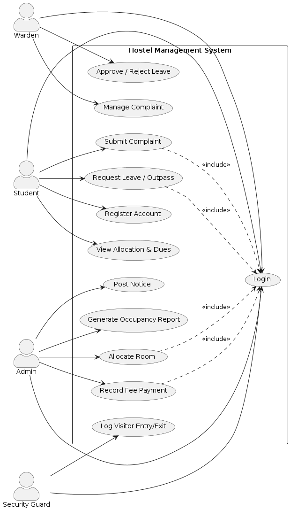

# Software Requirements Specification

---

## 1. Introduction

### 1.1 Purpose

This document specifies the software requirements for the **Hostel Management System (HMS)**, a web-based system that digitizes the day-to-day administrative and operational activities of a college hostel — student registration, room/bed allocation, fee collection, complaint handling, leave/outpass management, visitor logging, and notices. It is intended to be read by the project's developers, testers, and course evaluators, and it forms the contractual baseline against which the Test Plan (Section 4 of this project's deliverables) and the Software Architecture & Design Specification are traced.

### 1.2 Document Conventions

- Functional requirements are prefixed **FR-**, non-functional requirements **NFR-**, security objectives **SEC-OBJ-**, and security requirements **SEC-REQ-**, each with a sequential number (e.g., FR-1).
- The keywords **shall** (mandatory), **should** (recommended) follow RFC 2119-style usage.
- Requirements are written to be clear, unambiguous, concise, verifiable, and measurable — each includes an explicit, testable condition (a threshold, a limit, or an observable outcome) rather than a vague quality claim.

### 1.3 Intended Audience and Reading Suggestions

| Audience | Suggested Reading |
|---|---|
| Developers | Sections 2, 3, 4 |
| Testers / QA | Sections 3, 5, 6 (drives the Test Plan) |
| Architects | Sections 2, 3, 6 (drives the Architecture & Design Specification) |
| Evaluators | All sections |

### 1.4 Product Scope

HMS covers the core operational workflow of a single-campus hostel: student self-service (registration, viewing allocation and dues, raising complaints and leave requests), warden operations (complaint resolution, leave approval), admin operations (room allocation, fee recording, notices, occupancy reporting), and security-gate visitor logging. Out of scope for this phase: mess-menu planning, inventory/asset management, and multi-campus federation.

### 1.5 References

- IEEE Std 830-1998, *IEEE Recommended Practice for Software Requirements Specifications*.
- IEEE Std 829-2008, *IEEE Standard for Software and System Test Documentation* (referenced by the companion Test Plan).
- IEEE Std 1016-2009, *IEEE Standard for Information Technology — Systems Design — Software Design Descriptions* (referenced by the companion Architecture & Design Specification).
- OWASP Top 10 (2021), used as the baseline for the security requirements in Section 6.

---

## 2. Overall Description

### 2.1 Product Perspective

HMS is a new, self-contained, three-tier web application (browser client → REST API → relational database) replacing manual register-based hostel administration. It integrates with a single external system: a third-party payment gateway for online fee payment.

### 2.2 Product Functions

At a high level, HMS provides: account registration and authentication; room/bed allocation; fee due tracking and payment recording; complaint/maintenance ticketing; leave/outpass request and approval; visitor entry/exit logging; notices/announcements; and occupancy reporting.

### 2.3 User Classes and Characteristics

| User Class | Description | Technical Expertise |
|---|---|---|
| Student | Resident who registers, views allocation/dues, raises complaints and leave requests | Low — casual web/mobile user |
| Warden | Manages complaints and leave approvals for an assigned hostel block | Low–Medium |
| Admin (Hostel Manager) | Allocates rooms, records payments, posts notices, generates reports | Medium |
| Security Guard | Logs visitor entry/exit at the gate | Low |

### 2.4 Operating Environment

- Client: modern desktop or mobile web browser (Chrome, Firefox, Edge — latest two major versions).
- Server: Linux-hosted REST API behind HTTPS.
- Database: relational database (PostgreSQL).
- No native mobile app in this phase; the web client is responsive.

### 2.5 Design and Implementation Constraints

- All data persistence must go through the API layer; no direct client-to-database access.
- All external communication must use TLS 1.2 or higher (see SEC-REQ-3).
- The system must be deliverable as a demonstrable academic mini-project within the course timeline.

### 2.6 Assumptions and Dependencies

- Each student has exactly one active hostel account per academic year.
- The third-party payment gateway sandbox is available for online-payment testing.
- Hostel block and room/bed inventory is seeded by the Admin before allocation begins.

---

## 3. Requirements

### 3.1 Functional Requirements (FR)

| ID | Requirement |
|---|---|
| FR-1 | The system shall allow a Student to register an account by providing name, roll number, department, contact number, and email, and shall reject registration if the roll number already exists. |
| FR-2 | The system shall allow a Student, Warden, Admin, or Security Guard to log in using a unique identifier and password, and shall lock the account for 15 minutes after 5 consecutive failed login attempts. |
| FR-3 | The system shall allow the Admin to allocate an available room and bed to a registered Student, and shall reject the allocation if the selected bed is already marked occupied. |
| FR-4 | The system shall allow a Student to view their current room/bed allocation and outstanding fee due amount within 2 seconds of the request. |
| FR-5 | The system shall allow a Student to submit a maintenance/complaint request specifying category (Electrical, Plumbing, Cleaning, Other) and a description of 10–500 characters, and shall assign it a unique complaint ID on submission. |
| FR-6 | The system shall allow the Warden to view complaints raised within their assigned hostel block and update each complaint's status to Open, In-Progress, or Resolved, with an optional remark. |
| FR-7 | The system shall allow a Student to submit a leave/outpass request specifying destination, from-date, to-date, and reason, and route it to their block's Warden for a decision. |
| FR-8 | The system shall allow the Warden to approve or reject a pending leave/outpass request and shall deliver an in-app notification of the decision to the Student within 1 minute. |
| FR-9 | The system shall allow the Security Guard to record a visitor's name, purpose of visit, and host student, capturing entry timestamp on arrival and exit timestamp on departure. |
| FR-10 | The system shall allow the Admin to record a fee payment (Cash or Online) against a Student's account and generate a receipt with a unique receipt number on success. |
| FR-11 | The system shall allow the Admin to post a notice/announcement visible to all Students or restricted to a specific hostel block. |
| FR-12 | The system shall allow the Admin to generate an occupancy report showing total, occupied, and vacant beds per hostel block, exportable as a PDF. |

### 3.2 Non-Functional Requirements (NFR)

| ID | Category | Requirement |
|---|---|---|
| NFR-1 | Performance | The system shall respond to 95% of student dashboard requests within 2 seconds under a load of 200 concurrent users. |
| NFR-2 | Availability | The system shall be available at least 99% of the time per calendar month, excluding maintenance windows announced at least 24 hours in advance. |
| NFR-3 | Usability | A first-time Student user shall be able to submit a complaint without external assistance within 3 minutes, as verified by a usability test with at least 5 participants. |
| NFR-4 | Scalability | The system shall support at least 5,000 registered student accounts without response times exceeding the NFR-1 threshold. |
| NFR-5 | Maintainability | Backend service modules shall maintain a minimum of 70% automated unit-test code coverage. |
| NFR-6 | Portability | The web client shall render and function correctly on the latest two major versions of Chrome, Firefox, and Edge. |
| NFR-7 | Reliability | The system shall not lose any submitted complaint or leave request even if the server restarts, by persisting each submission to durable storage before acknowledging it to the client. |
| NFR-8 | Compatibility | The system shall expose a versioned, documented REST API returning JSON, so that a new API version does not break existing client integrations. |

---

## 4. External Interface Requirements

### 4.1 User Interfaces

- Responsive web UI with role-specific dashboards for Student, Warden, Admin, and Security Guard.
- Form validation shall display inline error messages for invalid input (e.g., malformed email, out-of-range dates).

### 4.2 Hardware Interfaces

- None beyond a standard client device (desktop/laptop/smartphone) with a web browser and network connectivity.

### 4.3 Software Interfaces

- REST/JSON API between web client and server (see Architecture & Design Specification, Section 4.2, for endpoint details).
- Integration with a third-party Payment Gateway API for online fee payments (FR-10).

### 4.4 Communications Interfaces

- All client-server traffic over HTTPS (TLS 1.2+), per SEC-REQ-3.

---

## 5. Use Case Diagram

The diagram below identifies four actors — **Student**, **Warden**, **Admin**, and **Security Guard** — and their interactions with the system's principal use cases. `Login` is an `<<include>>` dependency of every action that requires an authenticated session.

*Source: `diagrams/src/use-case-diagram.puml`*

### 5.1 Use Case Summaries

| Use Case | Primary Actor | Related Requirement(s) |
|---|---|---|
| Register Account | Student | FR-1 |
| Login | Student, Warden, Admin, Security Guard | FR-2 |
| View Allocation & Dues | Student | FR-4 |
| Submit Complaint | Student | FR-5 |
| Manage Complaint | Warden | FR-6 |
| Request Leave / Outpass | Student | FR-7 |
| Approve / Reject Leave | Warden | FR-8 |
| Log Visitor Entry/Exit | Security Guard | FR-9 |
| Allocate Room | Admin | FR-3 |
| Record Fee Payment | Admin | FR-10 |
| Post Notice | Admin | FR-11 |
| Generate Occupancy Report | Admin | FR-12 |

---

## 6. Security Section

### 6.1 Security Objectives

| ID | Objective |
|---|---|
| SEC-OBJ-1 | Protect the confidentiality of students' personally identifiable information (PII) and fee/payment data against unauthorized access or disclosure. |
| SEC-OBJ-2 | Preserve the integrity of hostel records — room allocation, fee ledger, and complaint status — so they cannot be modified by unauthorized users or processes. |
| SEC-OBJ-3 | Preserve the availability of core hostel services against common abuse patterns, including brute-force login attempts. |

### 6.2 Security Requirements

| ID | Requirement |
|---|---|
| SEC-REQ-1 | The system shall store all user passwords using a salted, one-way hash (bcrypt, cost factor ≥ 10); plaintext passwords shall never be persisted or logged. |
| SEC-REQ-2 | The system shall enforce role-based access control (RBAC) across the Student, Warden, and Admin roles such that a Student cannot read or modify another student's personal or fee records. |
| SEC-REQ-3 | All client-server communication shall use TLS 1.2 or higher; the server shall reject unencrypted HTTP connections to any API endpoint. |
| SEC-REQ-4 | The system shall validate and sanitize all user-supplied input on the server side to prevent SQL Injection and Cross-Site Scripting (XSS), verified through automated security scanning with zero high-severity findings prior to release. |
| SEC-REQ-5 | The system shall record all authentication events (success and failure) and administrative actions (fee edits, room allocation changes) in an append-only audit log retained for a minimum of one year. |

---

## 7. Appendix — Requirements Traceability

Traceability from these requirements to design components (Architecture & Design Specification) and to verification (Test Plan) is maintained in the Test Plan's Traceability Matrix (Section 6) and the Architecture document's Section 3.4.
